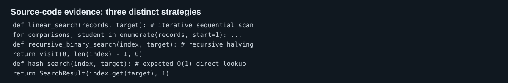
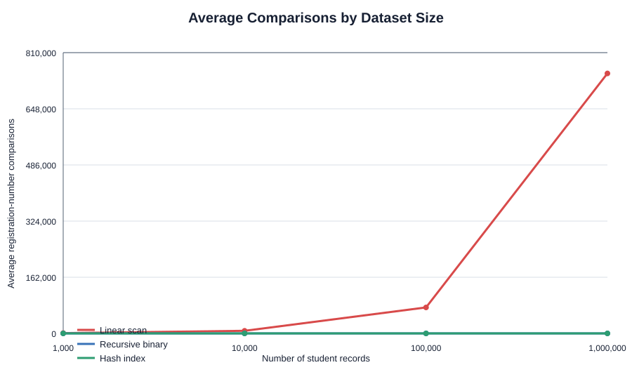
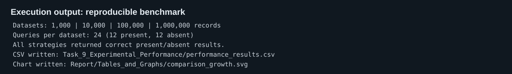

# CO1 Assignment - Efficient Student Record Search Strategy

**Course:** CSA06 Design and Analysis of Algorithms  
**Scenario:** University Student Record Retrieval  
**Objective:** Find a unique student registration number as the database grows from 1,000 to 1,000,000 records.

## Task 1 - Algorithm Design

The dataset contains records `(registration_number, student_details)`. Registration numbers are unique. Three genuinely different strategies were selected.

### A. Iterative linear search

The algorithm visits records in their stored order until the target registration number matches. It needs no preprocessing and is useful as a simple baseline or for a very small, unsorted collection.

```text
LINEAR-SEARCH(records, target)
  for each student in records
      if student.registration_number = target
          return student
  return NOT_FOUND
```

### B. Recursive binary search over a sorted index

First, create an index ordered by registration number. Search compares the target with the middle item and recursively searches exactly one half. This is recursive; it is algorithmically distinct from the scan because each comparison discards half the candidate records.

```text
BINARY(index, target, low, high)
  if low > high: return NOT_FOUND
  middle = floor((low + high) / 2)
  if index[middle].registration_number = target: return index[middle]
  if target < index[middle].registration_number
      return BINARY(index, target, low, middle - 1)
  return BINARY(index, target, middle + 1, high)
```

Sorting costs `Theta(n log n)` before searching. In a real system, this is a sorted database index rebuilt/updated as records arrive.

### C. Hash-index lookup

Create a dictionary from registration number to full student record. A search hashes the target key and accesses its bucket. This is a direct-access/indexing strategy, not a variation of either comparison search.

```text
BUILD-HASH(records): index[record.registration_number] = record
HASH-SEARCH(index, target): return index.get(target, NOT_FOUND)
```

Building the index is `Theta(n)` expected time and space. It is especially appropriate when repeated searches greatly outnumber updates.

## Task 2 - Basic Operation

| Strategy | Basic operation | Location and justification | Growth |
|---|---|---|---|
| Linear | `student.registration_number == target` | Executed once for every visited record; it determines when the scan ends. | 1 to `n` equality tests |
| Recursive binary | comparison of middle registration number with target | One decision at each recursion level selects the left or right half. | About `log2 n` comparisons |
| Hash index | dictionary lookup by registration number | The hash and key comparison select a bucket; report one logical lookup. | Expected constant; collision worst case can inspect `n` keys |

## Task 3 - Mathematical Complexity

Let `n` be the number of student records and `q` the number of search requests after preprocessing.

For linear search, a successful record in position `k` requires `k` comparisons; failure requires `n`. The single-search function is `C_L(n) = k` or `n`, hence worst-case `T_L(n) = an + b`. For `q` searches, `Theta(qn)`; no preprocessing is required.

For binary search, sorting costs `S(n) = Theta(n log n)`. A search has one comparison then one subproblem of at most `floor(n/2)` items: `C_B(n) = C_B(floor(n/2)) + 1`. Thus the total workload is `Theta(n log n + q log n)`; sorted-index storage is `Theta(n)`.

For the hash index, construction performs one insertion per record: `H(n) = an + b` expected. Each lookup is expected `Theta(1)`, so total expected work is `Theta(n + q)`. It uses `Theta(n)` additional index storage.

## Task 4 - Best, Average, and Worst Case

| Strategy | Best case and count | Average case and count | Worst case and count |
|---|---|---|---|
| Linear | Target is first: 1 | Successful target is uniformly located: `(n + 1)/2` | Last target or absent: `n` |
| Recursive binary | Target is middle: 1 | `Theta(log n)` | Deepest path/absence: at most `ceil(log2(n + 1))` |
| Hash index | Key is in its expected bucket: 1 logical lookup | Expected `Theta(1)` under uniform hashing/load control | All keys collide: `Theta(n)` |

The conditions matter: linear search benefits from a frequently queried record placed first, binary search relies on order, and hashing relies on a well-distributed hash function and controlled load factor.

## Task 5 - Asymptotic Analysis

Linear search is `O(n)`, `Omega(1)`, and `Theta(n)` in the worst case. Recursive binary search is `O(log n)`, `Omega(1)`, and `Theta(log n)` per search, excluding index construction. Hash lookup is expected `Theta(1)` but `O(n)` in the pathological collision case.

When data grows from 1,000 to 1,000,000 (a factor of 1,000), linear worst-case work also grows by 1,000. Binary-search depth grows only from about 10 to 20 comparisons. Expected hash lookup does not grow with `n`, though memory grows linearly. This is why repeated retrieval makes indexing worthwhile.

## Task 6 - Recurrence Formulation

For recursive binary search, the original interval has `n` records. The middle comparison is constant work. If no match occurs, exactly one recursive call receives at most `floor(n/2)` records; the other half is discarded. The base case is an empty interval (`n = 0`) with no comparison. Therefore:

```text
T(0) = c0
T(n) = T(floor(n/2)) + c, for n > 0.
```

## Task 7 - Recurrence Solution

For `n = 2^k`, substitute repeatedly:

```text
T(n) = T(n/2) + c
     = T(n/4) + 2c
     = T(n/8) + 3c
     = ...
     = T(1) + c log2 n.
```

With constant `T(1)`, `T(n) = Theta(log n)`. The recurrence has one half-sized call (`a = 1`, `b = 2`), so the Master Theorem agrees: `n^(log_b a) = 1`, and constant combining work yields `Theta(log n)`. Recursion stack space is `Theta(log n)`.

## Task 8 - Implementation and Testing

The implementations are in `Task_8_Implementation_Testing/Source_Code/student_search.py`. The unit suite verifies agreement for a present record, correct absence detection, and linear-search position counts. The experiment uses equivalent deterministic unsorted datasets at exactly 1,000, 10,000, 100,000, and 1,000,000 records. There are 24 consistent queries per size: 12 hits distributed across the data and 12 absent keys.



## Task 9 - Experimental Performance

The benchmark was executed locally with Python 3. The following table is transcribed from the reproducible CSV. Times are mean microseconds per query; preprocessing is a one-time cost in microseconds.

| n | Strategy | Avg comparisons | Search time (us) | Preprocess (us) |
|---:|---|---:|---:|---:|
| 1,000 | Linear scan | 750.04 | 9.98 | 0.00 |
| 1,000 | Recursive binary | 9.38 | 4.32 | 50.58 |
| 1,000 | Hash index | 1.00 | 0.21 | 17.54 |
| 10,000 | Linear scan | 7,500.25 | 110.35 | 0.00 |
| 10,000 | Recursive binary | 13.29 | 1.32 | 290.21 |
| 10,000 | Hash index | 1.00 | 0.24 | 150.88 |
| 100,000 | Linear scan | 75,000.04 | 1,110.86 | 3.24 | 0.00 |
| 100,000 | Recursive binary | 16.12 | 2.89 | 3,238.92 |
| 100,000 | Hash index | 1.00 | 0.95 | 2,150.71 |
| 1,000,000 | Linear scan | 750,000.25 | 11,664.25 | 0.00 |
| 1,000,000 | Recursive binary | 19.58 | 4.02 | 35,542.38 |
| 1,000,000 | Hash index | 1.00 | 1.10 | 24,366.79 |





## Task 10 - Theory vs Experiment

Observed comparison counts agree directly with theory. The balanced benchmark has half absent searches, so linear search averages about `0.75n` comparisons: 750.04 at 1,000 and 750,000.25 at one million. Binary search rises very slowly, from 9.38 to 19.58 comparisons, as predicted by `log2 n`. Hash lookup stays at one logical lookup.

Wall-clock times contain effects not represented by Big-O: Python interpreter overhead, CPU cache, recursion-call overhead, dictionary implementation, timer resolution, and the small fixed sample size. For example, binary time is not perfectly monotonic at low `n`; that does not contradict its logarithmic comparison growth. Comparison counts are the more stable validation of the mathematical model.

## Task 11 - Final Recommendation

Use a **hash index keyed by registration number**, rebuilt or incrementally updated when daily records are added. The experiment shows the lowest mean search time and a constant logical lookup count, while the expected workload is `Theta(n + q)` rather than `Theta(n log n + q log n)` for sorting plus binary search. A sorted index is a strong fallback when ordered/range queries are required or deterministic `O(log n)` lookup is preferred. Linear search should not be used for the full database because repeated scans scale linearly.

Trade-offs: the hash index consumes `Theta(n)` extra memory and needs a robust, collision-resistant implementation. It does not naturally support ordered/range queries; maintain a sorted index as well only if those operations are required.

## Task 12 - Design Challenge

### A. Impact analysis

The system must now handle 50,000 searches per hour on 1,000,000 records, while additions occur only once daily. Searches are therefore the hot path: a linear scan would do roughly 37.5 billion comparisons per hour under the measured mixed workload, whereas updates are infrequent enough to justify preprocessing. The original assumption that no index is needed is no longer acceptable.

### B. Evaluation of the original design

The recommended hash index remains suitable. At one million records the measured one-time build was about 24.37 ms in this local test, while the measured mean lookup was about 1.10 us. Even allowing substantial database/network overhead, 50,000 per hour is only 13.89 requests/second, leaving a large capacity margin. Recursive binary search also meets throughput, but costs more per search and sorting took about 35.54 ms in the test.

### C. Decision: retain with an operational modification

Retain the hash-index strategy, but **modify operations** to rebuild or atomically swap a fresh index after the daily import. This avoids inconsistent partial updates, keeps lookup expected `Theta(1)`, and makes daily `Theta(n)` preprocessing explicit. Use persistent database indexing in deployment rather than relying on an in-memory Python dictionary alone.

### D. Evidence-based defence

The decision follows the workload: high query volume rewards the measured constant-time path, while one daily update amortizes the index build. At 1,000,000 records, the experiment observed one logical lookup versus 19.58 binary and 750,000.25 linear comparisons. The daily rebuild is negligible relative to 50,000 hourly queries under these local measurements. A sorted secondary index can be added only for requirements such as registration-number range reports.
